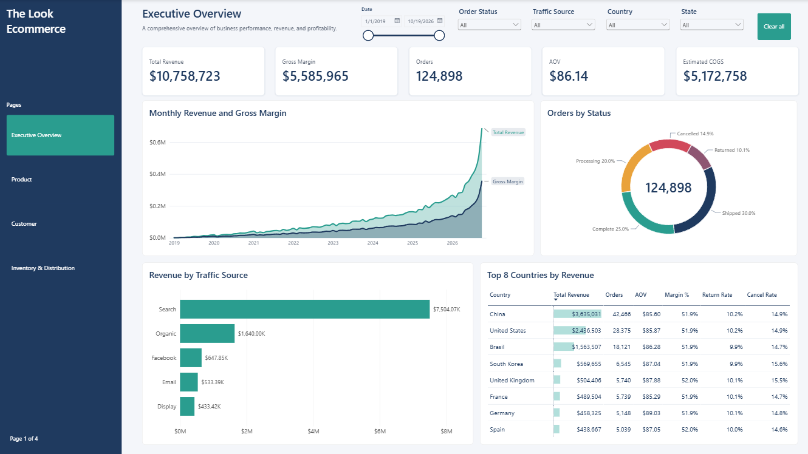
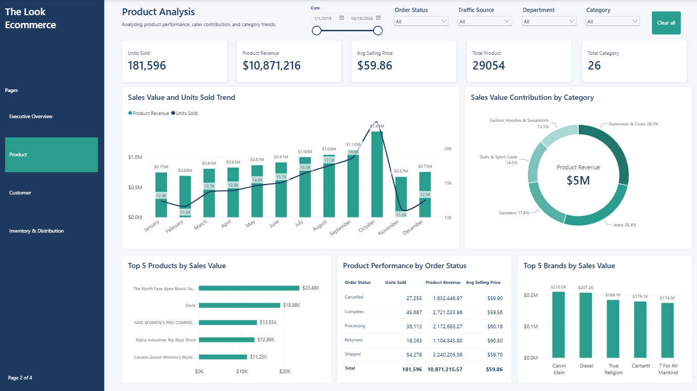
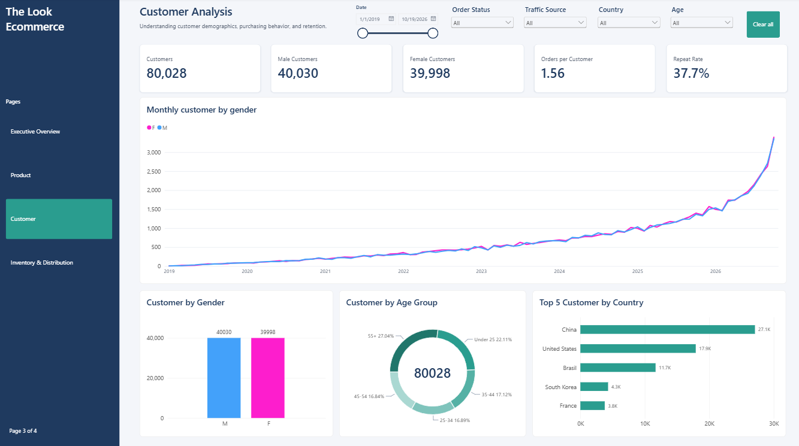
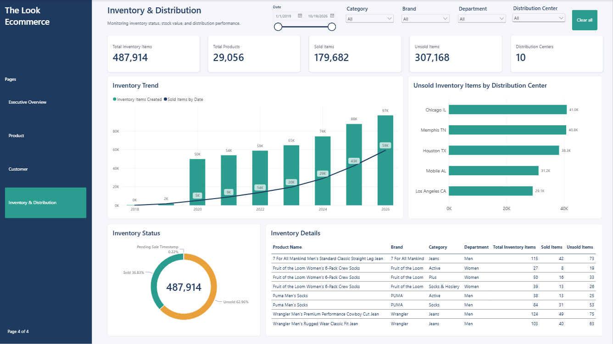

# TheLook Ecommerce Analytics Dashboard

**End-to-End Data Analytics Project | BigQuery • SQL • Power BI**

## 1. Project Overview

TheLook Ecommerce Analytics Dashboard merupakan project Data Analytics yang bertujuan untuk menganalisis performa bisnis e-commerce menggunakan dataset publik TheLook Ecommerce dari Google BigQuery.

Project ini mencakup proses analisis data secara end-to-end, mulai dari identifikasi business problem, data extraction, data preparation, exploratory data analysis (EDA), data modeling, hingga pengembangan interactive dashboard menggunakan Microsoft Power BI.

Dashboard dirancang untuk memberikan gambaran menyeluruh mengenai performa bisnis melalui empat halaman utama:

1. **Executive Overview:** Menampilkan gambaran umum performa bisnis, revenue, transaksi, dan profitability.
2. **Product Analysis:** Menganalisis performa produk, kategori, dan kontribusi penjualan.
3. **Customer Analysis:** Memahami karakteristik pelanggan, demographics, dan purchasing behavior.
4. **Inventory & Distribution:** Memantau kondisi inventory, nilai persediaan, dan performa distribution center.

Project ini dibuat sebagai studi kasus untuk menerapkan kemampuan SQL, data analysis, data visualization, dan business intelligence dalam menyelesaikan permasalahan bisnis berbasis data.

## 2. Business Problem

Dalam bisnis e-commerce, perusahaan menghasilkan data dalam jumlah besar dari berbagai aktivitas, seperti transaksi penjualan, informasi produk, profil pelanggan, aktivitas pengguna, dan pengelolaan inventory.

Namun, data tersebut belum tentu memberikan informasi yang mudah dipahami apabila tidak diolah dan dianalisis dengan tepat.

Beberapa permasalahan bisnis yang menjadi fokus dalam project ini adalah:

- **Business Performance:** Bagaimana kondisi performa bisnis berdasarkan revenue, jumlah transaksi, Average Order Value (AOV), dan profit margin?
- **Product Performance:** Produk dan kategori apa yang memberikan kontribusi terbesar terhadap penjualan?
- **Customer Behavior:** Bagaimana karakteristik pelanggan berdasarkan demographics dan purchasing behavior?
- **Inventory Management:** Bagaimana kondisi persediaan produk, nilai inventory, dan distribusinya di setiap distribution center?

### Business Objectives

Berdasarkan permasalahan tersebut, project ini memiliki beberapa tujuan:

1. Mengevaluasi performa bisnis melalui indikator penjualan dan profitability.
2. Mengidentifikasi produk dan kategori dengan kontribusi penjualan tertinggi.
3. Memahami karakteristik serta pola pembelian pelanggan.
4. Mengevaluasi kondisi inventory dan distribusi persediaan.
5. Menyajikan hasil analisis dalam bentuk interactive dashboard untuk mendukung pengambilan keputusan bisnis.

## 3. Dataset & Data Source

Dataset yang digunakan berasal dari **TheLook Ecommerce**, yaitu dataset publik yang tersedia melalui Google BigQuery.

**Data Source:**  
https://console.cloud.google.com/marketplace/product/bigquery-public-data/thelook-ecommerce

Dataset terdiri dari tujuh tabel utama:

| Table | Description |
|---|---|
| `orders` | Informasi transaksi dan status pesanan pelanggan. |
| `order_items` | Detail produk yang terdapat dalam setiap transaksi. |
| `users` | Informasi profil dan karakteristik pelanggan. |
| `products` | Informasi produk, kategori, brand, dan harga. |
| `inventory_items` | Informasi persediaan produk dan status penjualan inventory. |
| `distribution_centers` | Informasi lokasi dan koordinat distribution center. |
| `events` | Aktivitas pengguna selama berinteraksi dengan platform e-commerce. |

Dataset ini merupakan data sintetis yang dibuat untuk kebutuhan analisis dan pembelajaran. Oleh karena itu, hasil analisis digunakan sebagai simulasi studi kasus bisnis, bukan sebagai representasi performa perusahaan e-commerce yang sebenarnya.

## 4. Project Workflow

Project dikerjakan melalui lima tahapan utama.

### Step 1. Business Problem Identification

Tahap pertama adalah memahami permasalahan bisnis dan menentukan informasi apa saja yang perlu dihasilkan dari dataset.

Pada tahap ini, saya mengidentifikasi kebutuhan analisis berdasarkan empat aspek utama:

**A. Executive Overview**
- Total Revenue
- Total Orders
- Average Order Value (AOV)
- Gross Profit
- Gross Profit Margin
- Return Rate
- Cancel Rate

**B. Product Analysis**
- Product Revenue
- Total Units Sold
- Top Performing Products
- Sales by Category
- Revenue Contribution by Brand

**C. Customer Analysis**
- Total Customers
- Customer Demographics
- Customer Distribution by Country
- Purchasing Behavior
- Repeat Purchase Analysis
- Customer Retention

**D. Inventory & Distribution**
- Total Inventory Items
- Sold Items and Unsold Items
- Inventory Status Distribution
- Inventory Value
- Inventory by Distribution Center
- Inventory Trend

Hasil dari tahap ini menjadi dasar dalam menentukan kebutuhan data, SQL queries, KPI, dan visualisasi yang akan dikembangkan.

### Step 2. Data Extraction & Preparation

Tahap berikutnya adalah mengambil data dari Google BigQuery dan mempersiapkannya sebelum digunakan dalam proses analisis.

**A. Data Extraction**

Menggunakan Google BigQuery sebagai platform untuk mengakses dataset publik TheLook Ecommerce.

Tabel yang digunakan meliputi:
- `orders`
- `order_items`
- `users`
- `products`
- `inventory_items`
- `distribution_centers`
- `events`

**B. Data Preparation**

Data preparation dilakukan menggunakan SQL untuk memastikan data memiliki struktur yang sesuai dengan kebutuhan analisis.

Beberapa proses yang dilakukan:

- **Data Exploration:** Memahami struktur tabel, jumlah record, kolom, dan tipe data.
- **Data Quality Check:** Memeriksa missing values, duplicate records, serta konsistensi data.
- **Data Transformation:** Mengubah format tanggal, mengelompokkan data, dan membuat kolom turunan sesuai kebutuhan analisis.
- **Data Integration:** Menggabungkan tabel menggunakan JOIN berdasarkan key yang relevan.
- **Data Aggregation:** Menghitung metrik seperti revenue, jumlah transaksi, jumlah pelanggan, dan inventory value.


### Step 3. Exploratory Data Analysis (EDA)

Setelah data dipersiapkan, tahap berikutnya adalah melakukan Exploratory Data Analysis (EDA) untuk memahami karakteristik data, menemukan pola, dan mengidentifikasi informasi yang relevan dengan business problem.

EDA dilakukan menggunakan SQL dan hasil pengolahan data digunakan sebagai dasar pembuatan visualisasi.

**A. Executive Performance Analysis**

Menganalisis kondisi bisnis secara keseluruhan berdasarkan:
- Revenue trends.
- Order volume.
- Average Order Value.
- Gross Profit Margin.
- Return and cancellation patterns.

**B. Product Performance Analysis**

Menganalisis kontribusi produk terhadap penjualan dengan melihat:
- Produk dengan revenue tertinggi.
- Kategori produk dengan kontribusi terbesar.
- Jumlah unit produk yang terjual.
- Perbandingan performa brand.
- Product profitability.

**C. Customer Analysis**

Menganalisis karakteristik dan perilaku pelanggan melalui:
- Distribusi pelanggan berdasarkan gender dan age group.
- Customer distribution berdasarkan negara.
- Revenue berdasarkan gender.
- Pola pembelian pelanggan.
- Repeat purchase dan retention patterns.

**D. Inventory & Distribution Analysis**

Menganalisis kondisi persediaan dan distribusi melalui:
- Jumlah inventory items.
- Perbandingan sold dan unsold inventory.
- Inventory status.
- Inventory value.
- Distribusi inventory berdasarkan distribution center.
- Tren inventory berdasarkan waktu.

Hasil EDA digunakan untuk menentukan KPI, memilih visualisasi yang relevan, serta menemukan insight yang dapat mendukung pengambilan keputusan bisnis.

### Step 4. Dashboard Development

Tahap selanjutnya adalah mengembangkan interactive dashboard menggunakan Microsoft Power BI.

Data hasil pengolahan BigQuery dihubungkan ke Power BI untuk membangun data model, DAX measures, dan visualisasi.

**A. Data Modeling**

Menyusun hubungan antar tabel berdasarkan key yang sesuai dengan granularitas masing-masing data.

Beberapa hal yang diperhatikan:
- Relationship antar tabel.
- Cardinality.
- Filter direction.
- Date table.
- Konsistensi data antar analytical views.

**B. DAX Measures**

Menggunakan Data Analysis Expressions (DAX) untuk membuat perhitungan KPI dan metrik analisis.

Contoh measures yang digunakan:
- Total Revenue
- Total Orders
- Average Order Value
- Gross Profit
- Gross Profit Margin
- Return Rate
- Cancel Rate
- Total Customers
- Total Inventory Items
- Sold Items
- Unsold Items
- Inventory Value

**C. Dashboard Pages**

Dashboard terdiri dari empat halaman utama:

**1. Executive Overview**

Menampilkan ringkasan performa bisnis melalui KPI cards, revenue trends, order performance, dan analisis berdasarkan negara.

**2. Product Analysis**

Menampilkan performa produk berdasarkan revenue, units sold, category, brand, dan kontribusi penjualan.

**3. Customer Analysis**

Menampilkan customer demographics, distribusi pelanggan, purchasing behavior, dan analisis repeat purchase.

**4. Inventory & Distribution**

Menampilkan inventory status, inventory value, inventory trends, brand performance, serta distribusi persediaan berdasarkan distribution center.

**D. Dashboard Design**

Dashboard dirancang dengan pendekatan modern corporate minimalist menggunakan:
- KPI Cards untuk menampilkan indikator utama.
- Bar Charts untuk perbandingan kategori dan produk.
- Line Charts untuk melihat tren berdasarkan waktu.
- Donut Charts untuk distribusi kategori.
- Tables untuk menampilkan informasi secara lebih detail.
- Slicers untuk melakukan filtering secara interaktif.

Tujuan utama visualisasi adalah menyajikan informasi secara ringkas, mudah dipahami, dan relevan dengan kebutuhan analisis bisnis.

## 5. Dashboard Preview

Dashboard terdiri dari empat halaman analisis.

### Executive Overview
Menampilkan ringkasan performa bisnis dan indikator utama untuk memahami kondisi bisnis secara keseluruhan.



### Product Analysis
Menyajikan analisis performa produk, kategori, dan kontribusi penjualan.



### Customer Analysis
Menyajikan informasi mengenai karakteristik pelanggan dan pola pembelian.



### Inventory & Distribution
Menyajikan analisis kondisi persediaan dan distribusi inventory.



## 6. Business Insights & Recommendations

Berdasarkan hasil analisis, dashboard dapat digunakan untuk mengidentifikasi beberapa area yang perlu diperhatikan oleh bisnis.

Berikut rekomendasi yang dapat dipertimbangkan berdasarkan masing-masing area analisis.

### A. Executive Overview

**Insight yang dianalisis:**
- Revenue dan order volume memberikan gambaran mengenai performa bisnis.
- AOV menunjukkan rata-rata nilai transaksi pelanggan.
- Gross Profit Margin membantu memahami tingkat keuntungan kotor.
- Return Rate dan Cancel Rate membantu mengevaluasi kualitas transaksi.

**Business Recommendations:**
- Memantau perubahan revenue dan order volume secara berkala.
- Mengevaluasi faktor yang memengaruhi profit margin.
- Mengidentifikasi penyebab return dan cancellation untuk mengurangi potensi kehilangan pendapatan.
- Memprioritaskan analisis pada metrik yang menunjukkan perubahan signifikan.

### B. Product Analysis

**Insight yang dianalisis:**
- Perbandingan revenue antarproduk dan kategori.
- Produk dengan kontribusi penjualan tertinggi.
- Perbedaan performa antarbrand.
- Perbandingan revenue dan profitability produk.

**Business Recommendations:**
- Mempertahankan ketersediaan produk dengan kontribusi revenue tinggi.
- Mengoptimalkan strategi promosi untuk kategori dengan performa penjualan rendah.
- Mengevaluasi produk berdasarkan revenue dan profit margin, bukan hanya jumlah unit terjual.
- Menggunakan product performance sebagai pertimbangan dalam perencanaan inventory.

### C. Customer Analysis

**Insight yang dianalisis:**
- Distribusi pelanggan berdasarkan demographics.
- Perbedaan revenue berdasarkan gender dan negara.
- Pola pembelian pelanggan.
- Repeat purchase dan retention patterns.

**Business Recommendations:**
- Mengembangkan strategi pemasaran berdasarkan karakteristik pelanggan.
- Mengidentifikasi kelompok pelanggan dengan kontribusi revenue yang tinggi.
- Mendorong repeat purchase melalui program loyalitas dan promosi yang relevan.
- Mengevaluasi customer retention untuk memahami potensi peningkatan loyalitas pelanggan.

### D. Inventory & Distribution

**Insight yang dianalisis:**
- Perbandingan sold dan unsold inventory.
- Nilai persediaan yang belum terjual.
- Distribusi inventory pada setiap distribution center.
- Perubahan jumlah inventory berdasarkan waktu.

**Business Recommendations:**
- Memantau produk dengan nilai unsold inventory yang tinggi.
- Mengevaluasi distribusi persediaan antar distribution center.
- Menyesuaikan perencanaan stok berdasarkan performa penjualan produk.
- Mengidentifikasi potensi overstock untuk mengurangi biaya penyimpanan.

**Note:** Rekomendasi di atas merupakan usulan analitis berdasarkan metrik yang tersedia. Implementasi bisnis memerlukan validasi lebih lanjut terhadap kondisi operasional perusahaan.

## 7. Tools & Technologies

| Tools | Usage |
|---|---|
| Google BigQuery | Data extraction, storage, and SQL processing |
| SQL | Data exploration, transformation, integration, and aggregation |
| Microsoft Power BI | Dashboard development and data visualization |
| DAX | KPI calculation and analytical measures |
| Power Query | Data transformation and preparation |
| Git & GitHub | Project version control and documentation |

## 8. Skills Demonstrated

Melalui project ini, beberapa kemampuan Data Analytics yang diterapkan meliputi:

- **Business Understanding:** Mengidentifikasi business problem dan menentukan kebutuhan analisis.
- **SQL & Data Manipulation:** Melakukan data extraction, cleaning, transformation, JOIN, dan aggregation.
- **Exploratory Data Analysis:** Memahami karakteristik data dan mengidentifikasi pola.
- **Data Modeling:** Menyusun hubungan antar tabel untuk kebutuhan analisis.
- **DAX:** Membuat calculated measures dan KPI.
- **Data Visualization:** Mengembangkan interactive dashboard menggunakan Power BI.
- **Analytical Thinking:** Menginterpretasikan hasil analisis dan menyusun business recommendations.

## 9. Repository Structure

Struktur repository project:

```text
thelook-ecommerce-analysis/
│
├── SQL/
│   ├── 01_create_snapshot.sql
│   ├── 02_create_views.sql
│   └── 03_data_validation.sql
│
├── PowerBI/
│   ├── thelook-ecommerce-analysis.pbip
│   ├── thelook-ecommerce-analysis.Report/
│   └── thelook-ecommerce-analysis.SemanticModel/
│
├── screenshots/
│   ├── executive-overview.png
│   ├── product-analysis.png
│   ├── customer-analysis.png
│   └── inventory-distribution.png
│
└── README.md
```

Nama file dan folder dapat disesuaikan dengan struktur repository yang digunakan.

## 10. How to Use This Project

Untuk mempelajari atau menjalankan project ini:

1. Clone repository dari GitHub.
2. Akses dataset TheLook Ecommerce melalui Google BigQuery.
3. Jalankan SQL scripts sesuai urutan untuk membuat snapshot dan analytical views.
4. Hubungkan Power BI ke tabel atau views yang telah dibuat di BigQuery.
5. Buka file Power BI Project (`.pbip`) menggunakan Microsoft Power BI Desktop.
6. Sesuaikan koneksi data dan lakukan refresh apabila diperlukan.
7. Gunakan slicers dan visualisasi untuk mengeksplorasi hasil analisis.

**Requirements:**
- Google account dengan akses Google BigQuery.
- Microsoft Power BI Desktop.
- Akses ke dataset publik TheLook Ecommerce.

## 11. Project Limitations

Beberapa hal yang perlu diperhatikan ketika menggunakan hasil analisis:

- Dataset TheLook Ecommerce merupakan dataset sintetis, sehingga tidak sepenuhnya merepresentasikan kondisi bisnis nyata.
- Dataset publik dapat mengalami perubahan atau regenerasi data.
- Hasil analisis bergantung pada snapshot data yang digunakan.
- Beberapa metrik, seperti return rate dan cancel rate, perlu diinterpretasikan berdasarkan definisi dan denominator yang digunakan.
- Analisis inventory menggambarkan kondisi berdasarkan informasi yang tersedia pada dataset, bukan jaminan ketersediaan stok operasional secara real-time.

## 12. Author

**Kevin Widjaya**

Fresh Graduate in Informatics | Data Analyst Enthusiast

Universitas Bunda Mulia

Interested in Data Analytics, Business Intelligence, and Data Visualization.

- GitHub: https://github.com/KevinWidjaya31
- LinkedIn: [https://www.linkedin.com/in/kevin-widjaya/]

---

**Project Type:** Personal Data Analytics Portfolio Project  
**Domain:** E-commerce  
**Focus:** Business Intelligence & Data Analytics  
**Tools:** BigQuery, SQL, Microsoft Power BI, DAX

